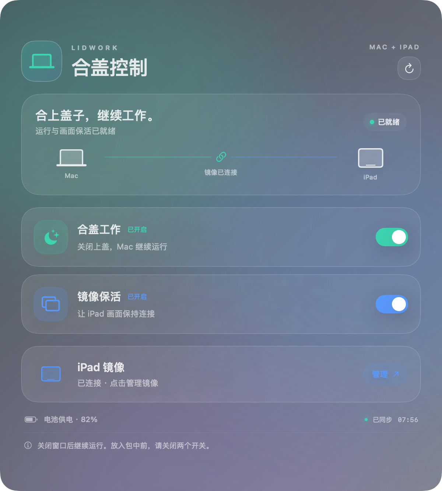
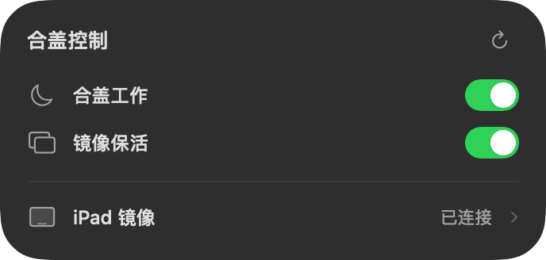
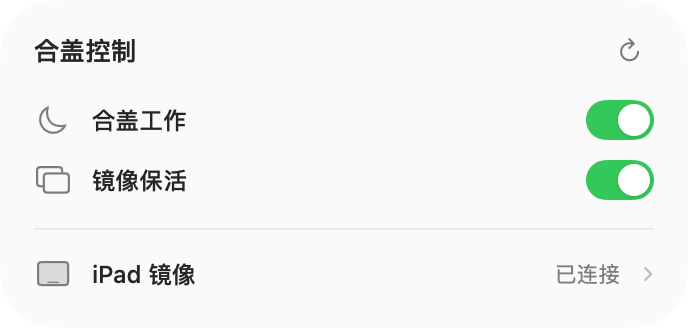

# LidWork · 合盖工作开关

让 MacBook 合盖后继续运行，并在本机验证可通过 iPad 随航继续显示和操作。提供原生 macOS 桌面小组件，包含「合盖工作」「镜像保活」「连接 iPad 镜像」三个操作。

这是面向个人设备的 macOS 工具。**当前发布包适用于 Apple Silicon（ARM64）；完整的小组件功能需要 macOS 14 或更新版本。** 已在 M4 MacBook Air、macOS 27.0.1 上使用；其他机型和系统版本尚未逐一验证。

## 下载与使用

从 [Releases](https://github.com/YZQForest/LidWork/releases/latest) 下载：

| 文件 | 用途 |
| --- | --- |
| `LidWork-1.5.1-macos-arm64.dmg` | 打开磁盘映像，把应用拖到 Applications |
| `LidWork-1.5.1-macos-arm64.zip` | 解压得到完整 `.app`，可放到应用程序或桌面 |
| `SHA256SUMS.txt` | 校验安装包完整性 |

1. 把应用复制到固定位置，打开「合盖工作开关」。应用通常在后台运行，菜单栏会出现笔记本图标。
2. 桌面空白处右键 → **编辑小组件** → 搜索「合盖」→ 将中号「合盖控制」拖到桌面。
3. 开启 **合盖工作** 和 **镜像保活**，再点 **连接 iPad 镜像**。保持 iPad 解锁，等画面出现后合盖。
4. 多台 iPad 时会显示设备选择。也可以使用系统「控制中心 → 屏幕镜像」。

首次更改合盖工作设置时，macOS 可能要求管理员验证。发布包使用 ad hoc 本地签名，**没有 Developer ID 签名或 Apple 公证**；从 GitHub 下载到其他 Mac 时可能出现 Gatekeeper 提示。请确认来源，或按下文从源码自行构建。

1.5.0 修复了更新后旧扩展驻留导致的状态不同步。App 与小组件共用同一套内核、显示画布和唤醒断言检测；操作完成后主动刷新，并合并快速操作后的尾部更新。原生小组件仍由 WidgetKit 调度，通常有数秒延迟。中号右上角可手动刷新；未知状态显示省略号，过期显示「待同步」，不会当作关闭。小号用于概览并打开控制台，中号提供三个直接操作。菜单栏 →「打开控制窗口…」可查看更及时的系统状态并管理 iPad 连接。右下角悬浮面板已移除，登录后台运行也不会自动弹出控制窗口。

> 合盖工作会暂停系统的自动和手动睡眠。合盖使用 iPad 时，两个开关都应开启；放进包里或长期不用前，请先打开上盖并关闭两个开关。

详细操作见 [使用说明](docs/USER_GUIDE.zh-CN.md)，验证范围见 [本机验证记录](docs/VERIFICATION.md)。

## 界面

App 使用原生 Liquid Glass（macOS 26+）、实时窗口背景模糊和高斯光晕；旧系统使用半透明材质。1.5.1 将小组件简化为两行开关和一行 iPad 入口，去掉装饰渐变、光晕和嵌套卡片。全彩模式使用中性背景；系统透明/着色样式由 WidgetKit 提供原生 Liquid Glass，避免用图片模拟透明。

以下是采用演示状态生成的内容预览，实时折射、窗口背景模糊和原生开关由 macOS 绘制：



 

## 三个操作如何工作

| 操作 | 实现 | 持续效果 |
| --- | --- | --- |
| 合盖工作 | 切换 `pmset -a disablesleep`，读取 IOKit 的实际 `SleepDisabled` 状态核对 | 退出应用后仍保留，关闭开关恢复系统睡眠 |
| 镜像保活 | 用户 LaunchAgent 持有虚拟显示画布和 `PreventUserIdleDisplaySleep` 断言 | 重新登录后按已保存的后台任务恢复；关闭会移除画布 |
| iPad 镜像 | 调用系统随航框架并设置镜像关系 | 已连接时显示状态；在菜单栏或控制窗口中可断开 |

内置屏幕在合盖后仍会关闭。虚拟画布用于保持可用的显示环境，不会让内置屏幕在盖内发光。应用不修改原有电池/电源睡眠定时、屏幕定时或网络权限。

随航连接与虚拟画布使用 macOS 的私有接口，系统更新可能影响可用性；这不是 App Store 应用。使用前需要设备本身满足 Apple 随航条件。系统更新后应重新验证合盖、供电和 iPad 镜像。

## 从源码构建

需要 macOS、包含 macOS 26+ SDK 的 Xcode Command Line Tools（或 Xcode 26+）和 Python 3。无需第三方包管理器或网络依赖。宿主应用和后台组件的部署目标为 macOS 13，小组件为 macOS 14；整个发布包以 macOS 14+ 为使用要求。

```sh
git clone https://github.com/YZQForest/LidWork.git
cd LidWork
./scripts/test.sh
./scripts/build.sh
./scripts/verify.sh --live-status
./scripts/package.sh
```

私有仓库需要先登录有权限的 GitHub 账号。构建结果在 `build/合盖工作开关.app`；ZIP、DMG、安装说明和 SHA-256 校验文件在 `dist/`。这些生成文件不进入 Git，程序分发放在 GitHub Release。

`verify.sh` 检查应用结构、版本、ARM64 架构、代码签名、WidgetKit 入口和扩展沙盒；`--live-status` 额外只读检查本机睡眠和保活状态，不会切换设置。GitHub Actions 执行构建、结构检查和打包，不代表完成真实合盖与 iPad 测试。

WidgetKit 扩展在命令行构建时显式使用 `_NSExtensionMain` 链接入口，这是本项目修复扩展启动崩溃所需的设置，详见 [开发说明](docs/ARCHITECTURE.md)。

## 源码布局

```text
src/
  App/
    main.swift                 应用生命周期、两个开关、操作队列、状态核验
    MenuController.swift       菜单栏、登录后台运行、iPad 管理
    Sidecar.swift              随航连接与镜像配置
    ControlDashboard.swift     原生玻璃控制台与深浅色布局
    PreviewRenderer.swift      明确标记为演示状态的内容预览
  NativeWidget/
    LidWorkNativeWidget.swift  WidgetKit 配置与时间线
    WidgetViews.swift          原生简约布局与三个操作链接
  Shared/                      两个进程共用的真实状态检测和视觉样式
  DisplayHelper/
    VirtualCanvas.m            虚拟画布、镜像跟随、显示器保活断言
resources/
  App/                         宿主 Info.plist 与图标
  NativeWidget/                扩展 Info.plist 与沙盒权限
scripts/                       构建、检查、打包与本机更新
tests/                         状态语义、旧状态操作、版本与进程匹配回归
tools/                         图标生成器与只读显示器诊断工具
docs/                          使用、安装、架构与验证说明
VERSION / BUILD_NUMBER         发布版本与 bundle build number
```

仓库只保留当前实现。旧版二进制、旧悬浮面板、诊断日志、设备标识和临时实验不进入源码仓库。

## 本机安装与更新

从源码构建后，可使用更新脚本（默认安装到桌面）：

```sh
python3 scripts/install_local.py --show
# 自定义位置：添加 --target "/Applications/合盖工作开关.app"
```

脚本检查宿主与扩展版本，备份现有程序，只停止目标 App 与其小组件，随后更新并重新注册；不会停止显示画布后台任务或改变开关。失败时恢复旧程序。

## 更新与卸载

更新前退出应用，把新 `.app` 覆盖到原安装位置。首次启动新 build 会自动清理本项目的旧小组件进程并重新注册，解决旧进程保留旧版本号造成的刷新失败。应用需保持完整，不能只复制其中的可执行文件，也不要移除 `Contents/PlugIns` 中的原生小组件。更新后如果小组件暂未刷新，可重新打开应用，必要时移除并重新添加桌面小组件。

卸载前打开上盖，关闭两个开关，菜单栏取消「登录时在后台运行」，退出应用后移除桌面小组件并删除 `.app`。完整的恢复命令和后台任务路径见 [使用说明](docs/USER_GUIDE.zh-CN.md#卸载和恢复)。

## 参考

- [Apple WidgetKit](https://developer.apple.com/documentation/widgetkit)
- [Apple PowerManagement / pmset](https://github.com/apple-oss-distributions/PowerManagement/blob/main/pmset/pmset.m)
- [Apple 显示器唤醒断言](https://developer.apple.com/documentation/iokit/kiopmassertiontypepreventuseridledisplaysleep)
- [Chromium 虚拟显示器接口示例](https://chromium.googlesource.com/chromium/src/+/cca923fbde2d338f3730885e0dbe734eee8465a2/ui/display/mac/test/virtual_display_mac_util.mm)
- [SidecarLauncher 的随航框架调用](https://github.com/Ocasio-J/SidecarLauncher)

参考项目与系统源码未作为依赖复制进本仓库。
